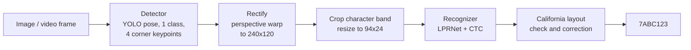
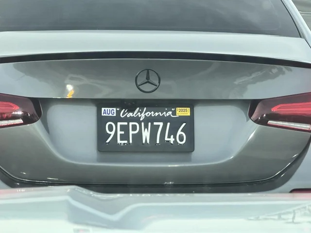
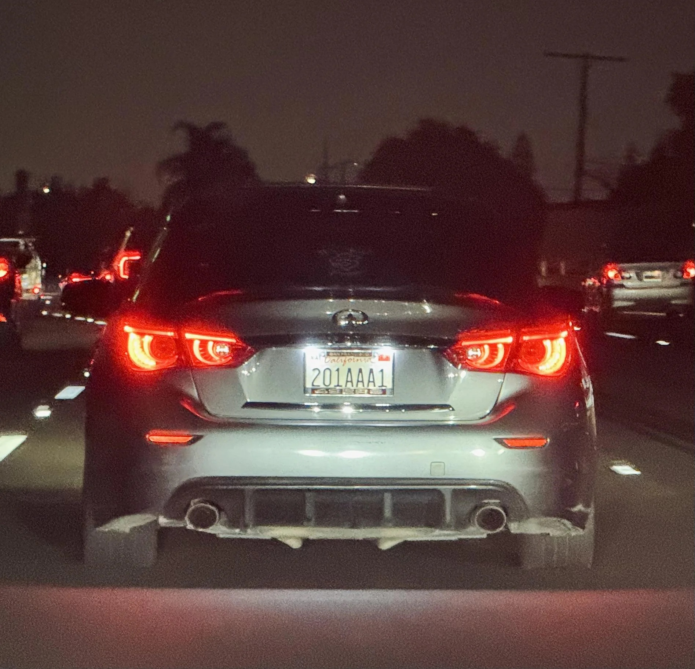
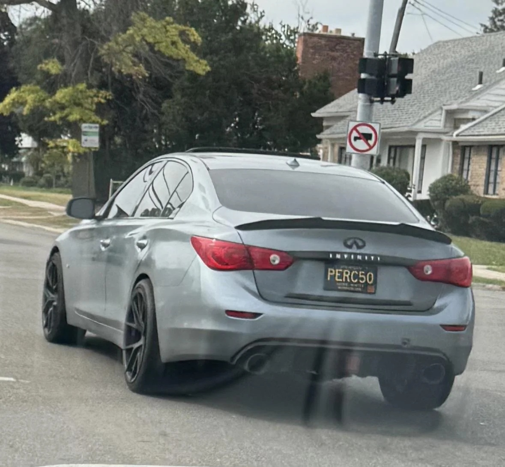
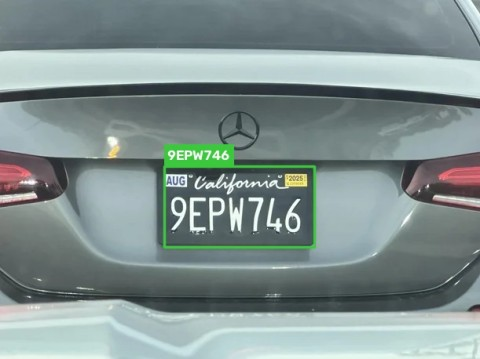
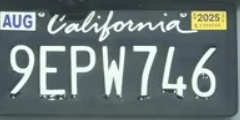
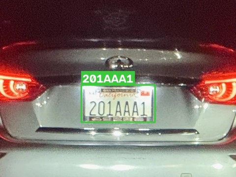
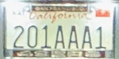
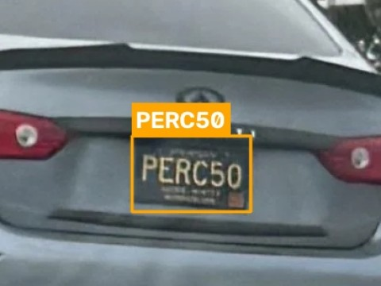
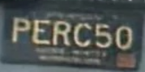

# California License Plate Recognition

[](https://github.com/azerbenali/California-License-Plate-Recognition/actions/workflows/ci.yml)

**Author:** Azer Ben Ali · 2026 · Apache License 2.0

An end-to-end automatic license plate recognition (ALPR) system for California
plates: a YOLO pose model finds each plate and its four corners, the plate is
perspective-corrected, and an LPRNet-style CTC model reads the characters. The
result is checked against California plate layouts and common OCR confusions
are corrected. Inference runs on CPU with [ncnn](https://github.com/Tencent/ncnn),
in C++17, with a core library that has no OpenCV dependency so it can be
reused on mobile.



## Sample photos

Three labeled photos in [`samples/`](samples/) exercise the whole system:
labels → dataset tools → training → ncnn export → detection and reading.

<table>
  <tr>
    <td align="center"></td>
    <td align="center"></td>
    <td align="center"></td>
  </tr>
  <tr>
    <td align="center"><code>9EPW746</code><br/>1980–2026 layout, black plate</td>
    <td align="center"><code>201AAA1</code><br/>2026+ layout, at night</td>
    <td align="center"><code>PERC50</code><br/>personalized, legacy black plate, angled</td>
  </tr>
</table>

## Demo run

These results come from running this repository's training pipeline once,
on a 2-core CPU, with the photos above, then reading the photos with the
exported ncnn models (`training.tools.run_ncnn`):

| Detection (detail) | Rectified plate | Read | Layout | Confidence (read / detect) |
|---|---|---|---|---|
|  |  | `9EPW746` | 1980–2026 | 1.00 / 0.63 |
|  |  | `201AAA1` | 2026+ | 1.00 / 0.92 |
|  |  | `PERC50` | personalized | 0.94 / 0.96 |

Green outline: the text fits a California layout. Orange: it does not
(here a personalized plate), so it is reported exactly as read. The full
output, with corner coordinates, is in [`docs/results/results.json`](docs/results/results.json).
How the models were trained:

- **Recognizer**: one epoch on 20,000 synthetic plates, then three epochs on
  the synthetic plates mixed with the 3 real crops (each used 300 times per
  epoch, augmented). It reads **99.2 %** of 1,000 held-out synthetic plates
  exactly (character error rate 0.12 %). This model is included as
  [`models/demo/`](models/README.md).
- **Detector**: a small YOLO pose model fine-tuned on the 3 photos
  (`prepare_dataset --repeat 4`). Its corner confidence is still below the
  0.5 threshold on these photos, so the pipeline rectified them from the
  detected box, which works for plates seen almost head-on. It is not
  included: train your own (step 2 below).

All three photos were in the training data, so this shows that every stage
works and fits together, **not** how well the system reads plates it has
never seen. That needs hundreds of labeled photos.

## Features

- **Multi-plate detection** with corner keypoints, so tilted and skewed plates are rectified before reading.
- **California-aware decoding**: recognizes the 2026+ `123ABC1` layout, the 1980–2026 `1ABC234` layout, commercial `1A23456` and trailer `1AB1234`; fixes confusions such as `8↔B`, `0↔O`, `2↔Z` by position, and knows that I, O and Q are not used as the first or third letter of the letter block. Personalized plates are passed through unchanged.
- **Image, video and webcam** input; annotated output image/video; JSON output; saving of rectified crops to grow the training set.
- **Training pipeline** in PyTorch for the recognizer (CUDA, Apple Silicon MPS, or CPU) and for the YOLO pose detector, both exported to ncnn.
- **Synthetic plates** in the standard white design and the dark designs seen on real cars (black, legacy black/blue/yellow), with stickers and dealer frames, for pretraining.
- **One command from labeled photos to training sets** (`prepare_dataset`), and a Python ncnn runner (`run_ncnn`) to check new models without building the C++ app.
- **Same preprocessing in training and deployment**, enforced by a test that compares the C++ and Python constants.
- **Unit tests** for decoding, geometry, warping and detector-output parsing, run on every push by GitHub Actions together with a full build of the app that reads the sample plates.

## California plate layouts handled

| Layout | Example | Pattern |
|---|---|---|
| Passenger, March 2026 onward | `123ABC1` | 3 digits, 3 letters, 1 digit |
| Passenger, 1980–2026 | `1ABC234` | 1 digit, 3 letters, 3 digits |
| Commercial | `1A23456` | 1 digit, 1 letter, 5 digits |
| Trailer | `1AB1234` | 1 digit, 2 letters, 4 digits |
| Personalized | `HELLO` | 2–7 characters, reported as read |

## Repository layout

```
include/calpr/        public headers
  config.hpp          shared constants (mirrored in training/common/config.py)
  plate_decoder.hpp   CTC decoding + California layout check/correction
  geometry.hpp        boxes, NMS, corner ordering, letterbox, homography
  image.hpp           BGR image view, row crop, perspective warp
  yolo_pose.hpp       YOLO pose output decoding (classic and end-to-end heads)
  detector.hpp  recognizer.hpp  pipeline.hpp
src/                  ncnn implementations + app/main.cpp (OpenCV CLI)
tests/                C++ and Python unit tests
training/
  common/             config, preprocessing and layout rules shared by all scripts
  recognition/        LPRNet model, dataset, training, ncnn export
  detection/          detector training and ncnn export (YOLO pose)
  tools/              dataset preparation, crop maker, synthetic plates, ncnn runner
samples/              3 labeled photos (images, corner labels, plate texts)
models/               put exported .param/.bin files here; demo/ has a smoke-test recognizer
docs/results/         output of the demo run shown above
.github/workflows/    CI: unit tests, full build, sample plates
```

## Build

Requirements: CMake 3.16+, a C++17 compiler, [ncnn](https://github.com/Tencent/ncnn)
(prebuilt packages are on its releases page), and OpenCV 4 for the app.

```bash
cmake -B build -Dncnn_DIR=/path/to/ncnn/lib/cmake/ncnn -DOpenCV_DIR=/path/to/opencv
cmake --build build --config Release
cd build && ctest -C Release
```

On macOS with Homebrew, `brew install ncnn opencv` usually lets CMake find both
without the `-D` options. To build only the unit tests (no dependencies):
`cmake -B build -DCALPR_BUILD_LIBRARY=OFF`. The CI workflow
(`.github/workflows/ci.yml`) shows a complete Ubuntu build with the official
ncnn release package.

## Run

Try the recognizer right after building, on a rectified sample plate, with
the demo model (see [`models/README.md`](models/README.md)):

```bash
./build/calpr_app --image docs/results/ca_plate_02_plate.png \
    --rec-param models/demo/ca_lprnet.ncnn.param --rec-bin models/demo/ca_lprnet.ncnn.bin
```

With your own models:

```bash
# Full pipeline on a photo
./build/calpr_app --image car.jpg \
    --det-param models/model.ncnn.param --det-bin models/model.ncnn.bin \
    --rec-param models/ca_lprnet.ncnn.param --rec-bin models/ca_lprnet.ncnn.bin \
    --out result.jpg

# Video file or webcam, JSON lines out
./build/calpr_app --video traffic.mp4 --det-param ... --det-bin ... \
    --rec-param ... --rec-bin ... --json --out annotated.mp4
./build/calpr_app --camera 0 ... --show

# Recognition only, on an already cropped plate
./build/calpr_app --image plate.png --rec-param ... --rec-bin ...
```

Example output:

```
7ABC123  (Passenger (1980-2026, 1ABC234), rec 0.97, det 0.91)
```

Run `calpr_app --help` for every option (thresholds, threads, blob names,
`--save-crops DIR` to collect rectified plates for labeling).

### From Python, without the C++ build

`run_ncnn` runs the same steps (letterbox, YOLO pose decoding, rectification,
character band, LPRNet, California layout check) with the `ncnn` pip package:

```bash
pip install ncnn opencv-python numpy
python -m training.tools.run_ncnn samples/images \
    --det models/model.ncnn.param --rec models/demo/ca_lprnet.ncnn.param \
    --out runs/demo
```

## Train your own models

All commands run from the repository root.

```bash
pip install -r training/requirements.txt
```

### 1. Label photos

Put photos in a folder laid out like [`samples/`](samples/README.md): `images/`,
one YOLO pose label file per photo in `labels/` (one class, four corner
keypoints in the order top-left, top-right, bottom-right, bottom-left), and
the plate texts in `plates.csv`. CVAT, Label Studio or Roboflow can export
the labels ("YOLO pose", 4 keypoints). Then build the training sets:

```bash
python -m training.tools.prepare_dataset --src samples --out data
```

This splits by photo into `data/det/` (detector) and cuts rectified plates,
with the same warp as the C++ pipeline, into `data/rec/` (recognizer). With
fewer than 10 photos, validation reuses the training photos.

`calpr_app --save-crops DIR` produces more recognizer crops from any video;
`python -m training.tools.make_rec_crops` cuts crops from an existing detector
dataset.

### 2. Detector (plate + 4 corners)

```bash
python -m training.detection.train_detector --data data/det --epochs 150
```

This trains from `yolo11n-pose.pt` and exports `runs/detector/train/weights/best_ncnn_model/`.
Copy its `model.ncnn.param` and `model.ncnn.bin` into `models/`. The C++
decoder also accepts the NMS-free output of YOLO26 models.

### 3. Recognizer warm-up on synthetic plates

```bash
python -m training.tools.synth_plates --out data/synth/train --count 20000
python -m training.tools.synth_plates --out data/synth/val --count 2000 --seed 1
python -m training.recognition.train --train data/synth/train --val data/synth/val \
    --epochs 30 --out runs/synth
```

### 4. Recognizer on real plates

Synthetic plates use generic fonts, so always fine-tune on real crops. Mixing
in the synthetic set keeps a small real set from being overfitted;
`--repeat` sets how many times each folder is used per epoch:

```bash
python -m training.recognition.train --train data/rec/train data/synth/train \
    --repeat 20 1 --val data/rec/val --init runs/synth/best.pt --out runs/recognizer
python -m training.recognition.export_ncnn --weights runs/recognizer/best.pt --out models
```

## Tests

```bash
(cd build && ctest -C Release)           # C++: decoder, geometry/warp, YOLO decoding
python tests/test_config_consistency.py  # C++ and Python constants agree
python tests/test_preprocess.py          # Python preprocessing, layouts, tools, sample labels
```

GitHub Actions runs all of them on every push, builds the full app against
the ncnn release package, reads the sample plates with the demo recognizer,
and attaches the output to the run (artifact `sample-results`).

## Limitations

- Accuracy depends entirely on the training data; collect plates in varied light, angles and distances.
- Motorcycle plates (smaller, different layout) and special-interest plates with symbols are not specifically handled; add them to the training data if you need them.
- The recognizer reads one line of characters, which fits standard California plates.
- Legacy plates have taller characters that start close to the top of the character band; label their corners on the plate edge (not inside it) so the band keeps the whole characters.

## Responsible use

License plates are personal data. If you deploy this system, check the laws
that apply to you; in California, automated license plate recognition systems
are regulated by Civil Code §1798.90.5 and following.

## License

Copyright 2026 Azer Ben Ali. Licensed under the Apache License, Version 2.0
(see `LICENSE`).
