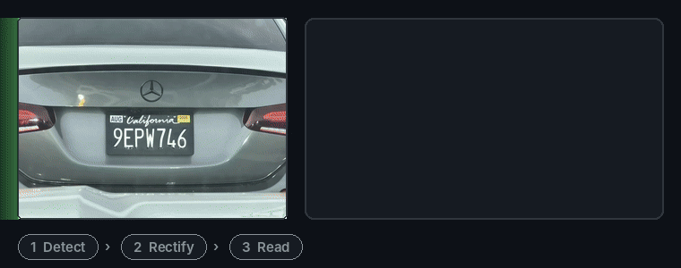
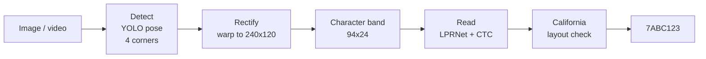

<p align="center">
  
</p>

<p align="center">
  <a href="../../actions/workflows/ci.yml"></a>
  
  
  
  
</p>

<p align="center">
  <a href="#demo">Demo</a> ·
  <a href="#how-it-works">How it works</a> ·
  <a href="#quick-start">Quick start</a> ·
  <a href="#training">Training</a> ·
  <a href="#project-structure">Structure</a>
</p>

---

## Demo

<p align="center">
  
</p>

<table align="center">
  <tr>
    <th></th>
    <th><code>9EPW746</code></th>
    <th><code>201AAA1</code></th>
    <th><code>PERC50</code></th>
  </tr>
  <tr>
    <td><b>Photo</b></td>
    <td></td>
    <td></td>
    <td></td>
  </tr>
  <tr>
    <td><b>Detect</b></td>
    <td></td>
    <td></td>
    <td></td>
  </tr>
  <tr>
    <td><b>Rectify</b></td>
    <td align="center"></td>
    <td align="center"></td>
    <td align="center"></td>
  </tr>
  <tr>
    <td><b>Read</b></td>
    <td align="center">✅ <code>9EPW746</code><br><sub>1980–2026 · conf 1.00</sub></td>
    <td align="center">✅ <code>201AAA1</code><br><sub>2026+ · conf 1.00</sub></td>
    <td align="center">✅ <code>PERC50</code><br><sub>personalized · conf 0.94</sub></td>
  </tr>
</table>

> [!NOTE]
> Demo models were trained on synthetic plates plus these 3 photos: a check that every stage works, not an accuracy benchmark.
> Recognizer: **99.2 %** exact reads on 1,000 held-out synthetic plates. Full output: [`docs/results/results.json`](docs/results/results.json).

## How it works



| | |
|---|---|
| **Detect** | Multi-plate YOLO pose detector with 4 corner keypoints |
| **Rectify** | Perspective correction, so tilted and skewed plates read like head-on ones |
| **Read** | LPRNet-style CTC recognizer, 37 classes |
| **Check** | Fixes `8↔B`, `0↔O`, `2↔Z` by position; knows I, O, Q rules; personalized plates pass unchanged |
| **Run** | C++17 on CPU with ncnn; core library free of OpenCV, portable to mobile |
| **Inputs** | Image, video, webcam → text, JSON, annotated output, plate crops |

### California layouts

| Layout | Example | Pattern |
|---|---|---|
| Passenger, March 2026 onward | `123ABC1` | 3 digits · 3 letters · 1 digit |
| Passenger, 1980–2026 | `1ABC234` | 1 digit · 3 letters · 3 digits |
| Commercial | `1A23456` | 1 digit · 1 letter · 5 digits |
| Trailer | `1AB1234` | 1 digit · 2 letters · 4 digits |
| Personalized | `HELLO` | 2–7 characters, reported as read |

## Quick start

**Requirements:** CMake 3.16+, C++17 compiler, [ncnn](https://github.com/Tencent/ncnn), OpenCV 4.

```bash
# macOS: brew install ncnn opencv
cmake -B build -Dncnn_DIR=/path/to/ncnn/lib/cmake/ncnn -DOpenCV_DIR=/path/to/opencv
cmake --build build --config Release
(cd build && ctest -C Release)
```

Read a sample plate with the demo recognizer:

```bash
./build/calpr_app --image docs/results/ca_plate_02_plate.png \
    --rec-param models/demo/ca_lprnet.ncnn.param --rec-bin models/demo/ca_lprnet.ncnn.bin
# 201AAA1  (Passenger (2026+, 123ABC1), rec ..., det ...)
```

<details>
<summary><b>More ways to run</b></summary>

```bash
# Full pipeline on a photo (your trained models)
./build/calpr_app --image car.jpg \
    --det-param models/model.ncnn.param --det-bin models/model.ncnn.bin \
    --rec-param models/ca_lprnet.ncnn.param --rec-bin models/ca_lprnet.ncnn.bin \
    --out result.jpg

# Video or webcam, JSON lines out
./build/calpr_app --video traffic.mp4 --det-param ... --det-bin ... \
    --rec-param ... --rec-bin ... --json --out annotated.mp4
./build/calpr_app --camera 0 ... --show

# Python, no C++ build
pip install ncnn opencv-python numpy
python -m training.tools.run_ncnn samples/images \
    --det models/model.ncnn.param --rec models/demo/ca_lprnet.ncnn.param --out runs/demo
```

`calpr_app --help` lists every option. `--save-crops DIR` collects rectified plates for labeling.
Unit tests only, no dependencies: `cmake -B build -DCALPR_BUILD_LIBRARY=OFF`.

</details>

## Training

```bash
pip install -r training/requirements.txt
```

| Step | Command |
|---|---|
| **1. Label** photos like [`samples/`](samples/README.md) | images + YOLO pose labels (4 corners) + `plates.csv` |
| **2. Prepare** datasets | `python -m training.tools.prepare_dataset --src samples --out data` |
| **3. Detector** | `python -m training.detection.train_detector --data data/det --epochs 150` |
| **4. Synthetic warm-up** | `python -m training.tools.synth_plates --out data/synth/train --count 20000` |
| **5. Recognizer** | `python -m training.recognition.train --train data/rec/train data/synth/train --repeat 20 1 --val data/rec/val` |
| **6. Export** | `python -m training.recognition.export_ncnn --weights runs/recognizer/best.pt --out models` |

<details>
<summary><b>Details</b></summary>

- **Labels:** CVAT, Label Studio or Roboflow export "YOLO pose" with 4 keypoints (top-left, top-right, bottom-right, bottom-left).
- **Prepare:** splits by photo into `data/det/` and cuts rectified plates into `data/rec/` with the same warp as the C++ pipeline. Below 10 photos, validation reuses the training photos.
- **Detector:** exports `runs/detector/train/weights/best_ncnn_model/`; copy `model.ncnn.param/.bin` into `models/`. YOLO26 end-to-end output is also supported.
- **Synthetic plates:** white, black and legacy designs with stickers and frames. Make a validation set with `--count 2000 --seed 1 --out data/synth/val`, pretrain with `python -m training.recognition.train --train data/synth/train --val data/synth/val --epochs 30 --out runs/synth`, then pass `--init runs/synth/best.pt` to step 5.
- **Recognizer:** `--repeat` sets how often each folder is used per epoch, so a few real plates are not drowned out by synthetic ones. Works on CUDA, Apple Silicon (MPS) and CPU.
- **More crops:** `calpr_app --save-crops DIR` on any video, or `python -m training.tools.make_rec_crops`.

</details>

## Project structure

<details>
<summary><b>Show tree</b></summary>

```
include/calpr/        public headers
  config.hpp          shared constants (mirrored in training/common/config.py)
  plate_decoder.hpp   CTC decoding + California layout check
  geometry.hpp        boxes, NMS, corner ordering, letterbox, homography
  image.hpp           BGR image view, row crop, perspective warp
  yolo_pose.hpp       YOLO pose output decoding
  detector.hpp  recognizer.hpp  pipeline.hpp
src/                  ncnn implementations + app/main.cpp (OpenCV CLI)
tests/                C++ and Python unit tests
training/
  common/             config, preprocessing, layout rules
  recognition/        LPRNet model, dataset, training, ncnn export
  detection/          detector training and ncnn export
  tools/              dataset prep, crops, synthetic plates, ncnn runner
samples/              3 labeled photos
models/               your exported models; demo/ = smoke-test recognizer
docs/                 README assets and demo results
.github/workflows/    CI
```

</details>

## Tests

```bash
(cd build && ctest -C Release)           # C++: decoder, geometry/warp, YOLO decoding
python tests/test_config_consistency.py  # C++ and Python constants agree
python tests/test_preprocess.py          # preprocessing, layouts, tools, sample labels
```

CI runs them on every push, builds the full app against ncnn and reads the sample plates.

## Notes

- Accuracy depends on the training data: collect plates in varied light, angles and distances.
- Motorcycle and special-interest plates with symbols are not specifically handled.
- One line of characters is read, which fits standard California plates.
- License plates are personal data. In California, ALPR systems are regulated by Civil Code §1798.90.5 and following.

## License

Copyright 2026 Azer Ben Ali. Licensed under the [Apache License, Version 2.0](LICENSE).
